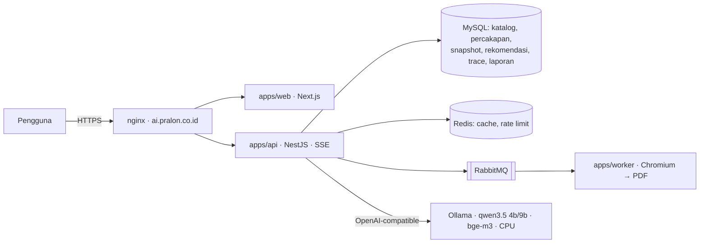
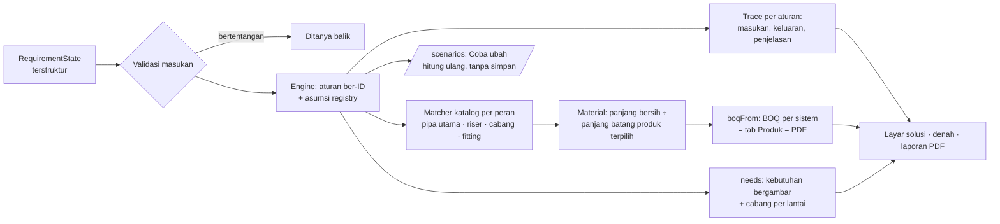
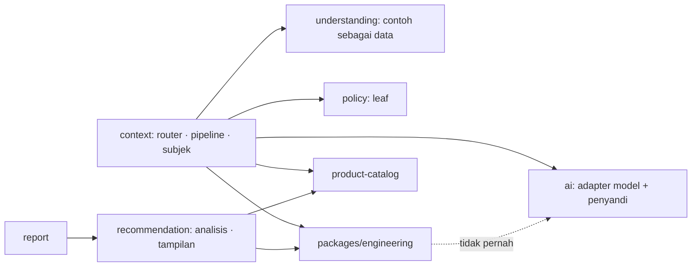

# Skema Arsitektur SNOUTY

Status per 12 Oktober 2026. Ringkasan untuk brainstorming; rujukan penuh di `docs/ARCHITECTURE.md`,
`docs/AI_BEHAVIOR.md`, `docs/CONTEXT_ENGINE.md`, dan `docs/ENGINEERING_RULES.md`.

## 1. Pembagian kerja: model vs kode

| Tugas                                                  | Siapa                                                                                        |
| ------------------------------------------------------ | -------------------------------------------------------------------------------------------- |
| Memahami maksud kalimat                                | Kemiripan vektor ke contoh berlabel (`bge-m3`); model hanya bila tidak ada contoh yang mirip |
| Membaca angka bersatuan (lantai, 8x15, 120 m², 20 l/s) | Parser nilai di kode                                                                         |
| Menghitung pipa, pompa, tangki, zona, material         | `packages/engineering` — aturan ber-ID, tanpa I/O, tanpa model                               |
| Fakta produk (jumlah, ukuran, kelas, panjang batang)   | Query SQL ke katalog aktif                                                                   |
| Pengetahuan perpipaan                                  | Fakta bersumber di `data/knowledge/` + konsep di kode                                        |
| Merangkai kalimat jawaban                              | Templat deterministik (mode hemat) atau model di atas DATA (mode kualitas)                   |
| Menjaga keluaran model                                 | Pagar kode: angka dan penanda teknis harus ada di DATA, nama pesaing ditolak                 |

## 2. Topologi produksi



Satu server 4 CPU tanpa GPU. Rilis per commit: build → (migrate) → up → smoke, lalu dicek di situs.

## 3. Satu giliran chat

```mermaid
flowchart TD
  P[Pesan] --> UND[Pemahaman: kemiripan ke ±1.900 contoh<br/>intent · topik · jenis kasus · aspek · format]
  UND --> S{Sosial / lanjutan subjek aktif?}
  S -->|ya| S1[Jawaban dari subjek / teks tetap]
  S -->|tidak| T{Topik pengetahuan bersumber?}
  T -->|ya| T1[Fakta + data katalog yang dihitung saat itu<br/>hemat: langsung · kualitas: dirangkai model]
  T -->|tidak| C{Kasus teknis / kebutuhan bangunan?}
  C -->|ya| C1[Parameter dari teks → kartu pertanyaan<br/>lengkap → tombol Susun rekomendasi]
  C -->|tidak| PR{Pertanyaan produk?}
  PR -->|ya| PR1[Katalog: keluarga, jenis, ukuran, kelas]
  PR -->|tidak dikenali| PL[Perencana giliran (model) ± 8 s]
```

Pagar di kode di setiap cabang: presedensi kebutuhan, kebijakan pesaing, harga tidak ditampilkan,
data yang bertentangan ditanya balik (mis. 20 lantai setinggi 10 m).

## 4. "Susun rekomendasi"



Durasi per tahap dicatat di log (`analisis`): engine ±3 ms, katalog ±31 ms, penyusunan ±13 ms.

## 5. Modul dan arah dependensi



Lint menggagalkan build bila `engineering` menyentuh `ai`/I/O atau `policy` bergantung ke modul lain.

`packages/ui` (13 Okt) bukan lagi hanya token: ilustrasi (sprite SVG dari mockup DD-01), pemilih
gambar kebutuhan dan produk, serta gambar denah dibangun ke `dist` supaya web dan laporan PDF di API
memakai kode yang sama; `shared-types` memuat `boqFrom`.

## 6. State percakapan

Bukan transkrip, melainkan `RequirementState`: field bangunan ber-provenance (lantai, kamar mandi,
wastafel, dapur, ukuran rumah, sumber, jenis instalasi), atau kasus teknis dengan parameter
universal (`design_flow`, `route_length`, `static_head`, `slope`, …), plus nilai asumsi yang diganti
pengguna dan subjek aktif. Setiap perubahan = snapshot append-only.

## 7. Sumber kebenaran dan provenance

| Sumber                           | Isi                                                                     | Status                                                  |
| -------------------------------- | ----------------------------------------------------------------------- | ------------------------------------------------------- |
| Katalog ERP aktif                | 7.681 SKU: nama, keluarga, kategori, ukuran, panjang batang (dari nama) | Produk nyata; kelas tekanan hanya yang tertulis di nama |
| `packages/engineering`           | 45 aturan ber-ID, registry parameter & asumsi dua bahasa                | Semua menunggu validasi ahli Pralon                     |
| `data/knowledge/pipe-facts.json` | Fakta per topik dari Knowledge Master HRGA + kait katalog               | Angka bertanda "perlu validasi" tidak dibawa            |
| Knowledge Master §7.1            | OD pipa uPVC per ukuran nominal                                         | Konsisten antarsumber; tebal dinding bertentangan       |
| Model (qwen3.5)                  | Merangkai kalimat di atas DATA, perencana giliran                       | Tidak pernah menjadi sumber fakta                       |

## 8. Pertanyaan arsitektur untuk dibahas

1. Apakah perlu retrieval dokumen penuh (indeks semua PDF/TDS Pralon dengan `bge-m3`) atau cukup
   fakta terkurasi per topik seperti sekarang?
2. Model: GPU di server, model berbayar per giliran, atau tetap CPU dengan mode hemat sebagai baku?
3. Membaca denah yang dilampirkan (OQ-56): ekstraksi ukuran ruangan/jalur otomatis, atau tetap
   ditanyakan?
4. Siapa merawat `data/understanding/` dan `data/knowledge/` setelah serah terima, dan dengan alat
   apa (back-office atau berkas)?
